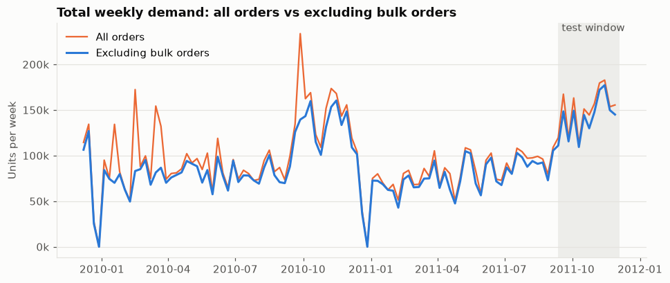
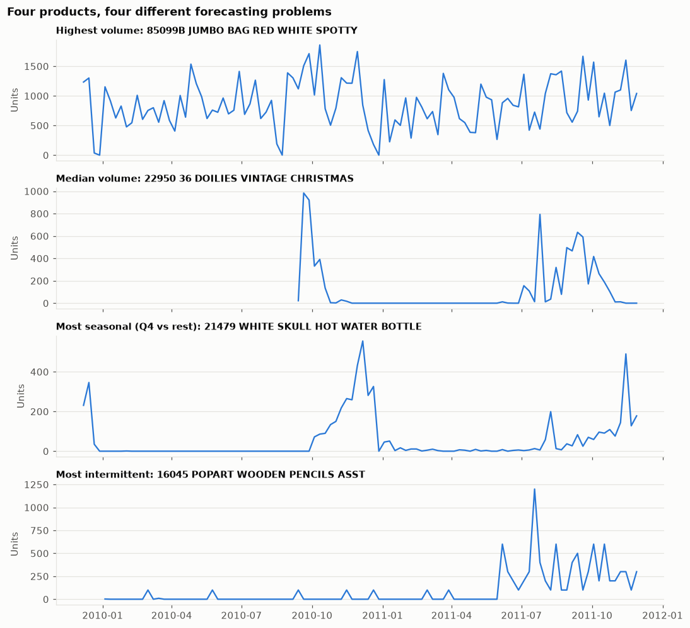
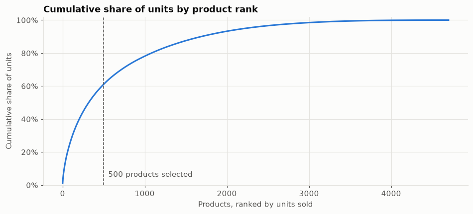
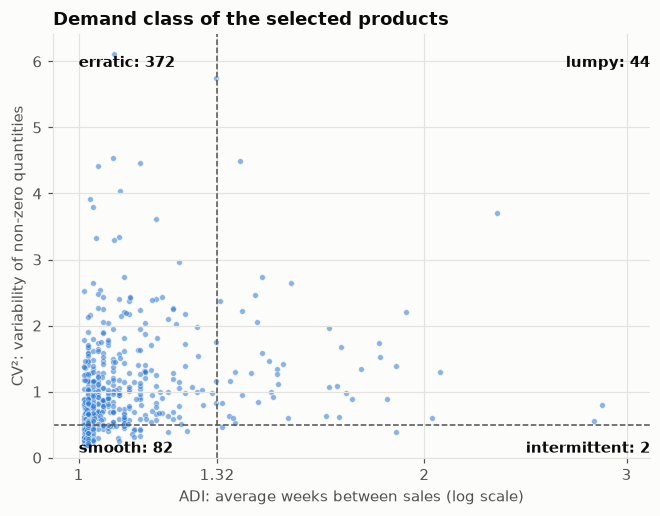

# Retail Demand Forecasting

Weekly demand forecasting per product on real retail invoice data, with proper backtesting, explainability and a served, monitored model.

> Work in progress. Sections below are filled in as each step is completed.

## Data

[Online Retail II](https://archive.ics.uci.edu/dataset/502/online+retail+ii) (UCI, CC BY 4.0): 1,067,371 invoice lines from a UK online gift-ware retailer, December 2009 to December 2011. Many customers are wholesalers, so the data behaves much like B2B sales lines in an ERP.

```bash
# put online_retail_II.xlsx in data/raw/, then:
uv run python -m forecasting.data.load    # xlsx -> data/interim/transactions.parquet
uv run python -m forecasting.data.clean   # -> data/processed/sales.parquet
```

## Cleaning

The goal is a table of **demand**: what customers actually ordered. Not net sales, not stock movements. Rules run in this order, because the order matters. For example, duplicates must go before cancellation matching, or a duplicated cancellation would cancel twice.

| # | Rule | Lines removed | Why |
|---|------|--------------:|-----|
| 1 | Stock codes to upper case | – | 3,366 lines use lower-case suffixes (`85123a`); the same product would otherwise appear under two codes |
| 2 | Drop exact duplicates | 34,335 | Identical invoice, item, quantity, price and minute, sometimes three copies of a line. Most likely an export join (e.g. against lots or serial numbers) that multiplied rows, not real repeat lines |
| 3 | Keep product codes only (`\d{5}[A-Z]*`) | 5,980 | Postage (`POST`, `DOT`, `C2`), discounts (`D`), manual entries (`M`), bank and Amazon fees, gift vouchers, test codes |
| 4 | Drop price ≤ 0 | 5,928 | Warehouse adjustments ("check", "damages", "?", "thrown away") and bad-debt entries |
| 5 | Drop quantity ≤ 0 that is not a cancellation | 0 | A safety net: all 3,457 such lines have price 0 and no customer, so rule 4 already removed them |
| 6 | Net cancellations against invoices | 17,914 cancellations, 7,178 invoice lines | See below |

**996,036 lines remain**, about 10.7M units.

### Cancellations

A cancelled order was never demand. Simply dropping the 19,494 cancellation lines would keep their original orders. One of them is a single order of 80,995 units, cancelled 12 minutes later. So each cancellation is matched to the invoice it cancels:

1. Customer and item must match, and the invoice must come before the cancellation.
2. **Exact quantity match first**, taking the most recent invoice. This catches full cancellations: 6,354 lines, including both huge orders (invoices 541431 and 581483).
3. **Otherwise allocate FIFO** across that customer's invoices for the item, which handles partial returns: 9,648 lines.
4. What cannot be matched is dropped and counted: 328 cancellations without a customer, plus returns of goods bought before the data starts. That is 17,480 of 467,739 cancelled units (3.7%).

**FIFO or LIFO?** Only partial returns go through allocation, so the choice should barely matter. Measured with `scripts/compare_cancel_strategies.py`, switching to LIFO moves 18,743 units between weeks: 0.18% of all units, in 3% of item-weeks. FIFO is kept.

**Open assumption:** a return weeks later also reduces demand in the week of the original order. Arguably that demand was real at the time, since the goods left the warehouse. This remains to be tested.

### Not removed: bulk orders

The largest remaining lines are real one-off wholesale orders. Examples: 19,152 mugs and about 12,500 each of four party-tableware sets for one Danish customer at £0.10 each, and 4 × 10,000 tissue packs for one UK customer. They are real sales, so the cleaning step keeps them. They are not repeatable demand, though, so they are handled at the modelling stage (see Exploratory analysis).

## Exploratory analysis

Notebook: [`notebooks/01_eda.ipynb`](notebooks/01_eda.ipynb). Weekly table: `uv run python -m forecasting.data.weekly`.



- **104 full weeks**, 2009-12-07 to 2011-11-28. The partial first and last weeks are dropped. **The last 12 weeks (from 2011-09-12) are the test window.** Product selection and the bulk threshold are computed only from the weeks before it.
- **Seasonality:** demand peaks September to November, not December. Wholesale customers stock up ahead of Christmas. The shape repeats in both years, but two years means the yearly cycle is seen only twice. The test window sits on the peak.
- **Each product has its own season.** Christmas items sell only from September to November, hot-water bottles through the winter, and some products change regime mid-way. A single global seasonality would not fit them.



### Calendar

The shop trades Sunday to Friday, so a normal week has 6 trading days (89 of 104 weeks). All 15 short weeks are UK holidays: the Christmas closure (two weeks with no sales at all), Easter, the May and August bank holidays, and the royal wedding on 2011-04-29. Their effect is large: the 4-day week of 2011-04-25 sold about 50k units against more than 75k around it. Closures are known in advance, so **trading days per week** is a feature, not only an explanation. No short weeks fall inside the test window.

### Products

- 4,698 products, very concentrated: the top 100 carry 27% of units, the top 500 61%, the top 1,000 78%.
- **500 products are selected**: at least 52 weeks of history and at least one sale in the 12 weeks before the test window, which excludes discontinued items. Ranking is by volume excluding bulk orders. Together they cover 57% of units: 49,021 product-weeks, 8.6% of them zero.



### Bulk orders and the forecasting target

The bulk rule flags a line above 20× the product's median line and at least 500 units: 833 lines, 9.7% of units, 126 customers, with one Danish customer alone at 21%. Tightening the rule lowers the share only slowly, so there is no natural cut-off. The chosen rule sits mid-range:

| Factor | Min units | Lines | Share of units | Repeat share |
|-------:|----------:|------:|---------------:|-------------:|
| 10 | 500 | 922 | 10.3% | 50% |
| **20** | **500** | **833** | **9.7%** | **48%** |
| 50 | 500 | 608 | 8.1% | 42% |
| 100 | 1,000 | 183 | 5.1% | 37% |

About half of bulk volume repeats (same customer, same product), but it still arrives as a few huge lines in unpredictable weeks.

**Target: weekly demand excluding bulk orders.** This mirrors how an ERP plans: the forecast drives replenishment for regular demand, while large wholesale orders arrive as quotes or contracts with a lead time and are planned as known demand. To hide nothing, evaluation also reports error against total demand.

### Demand classes and what they mean for evaluation



Syntetos–Boylan classification of the 500 products: **372 erratic**, 82 smooth, 44 lumpy, 2 intermittent. Most products sell almost every week, but in very unstable quantities. Consequences for evaluation:

- **No MAPE**: 8.6% of product-weeks are zero, so percentage errors break.
- **WAPE** (total absolute error / total demand) as the headline business metric, and **MASE** to compare against a naive forecast per product.
- **Seasonal naive** (same week last year) is a natural baseline. With two years of data it exists only for the second year.
